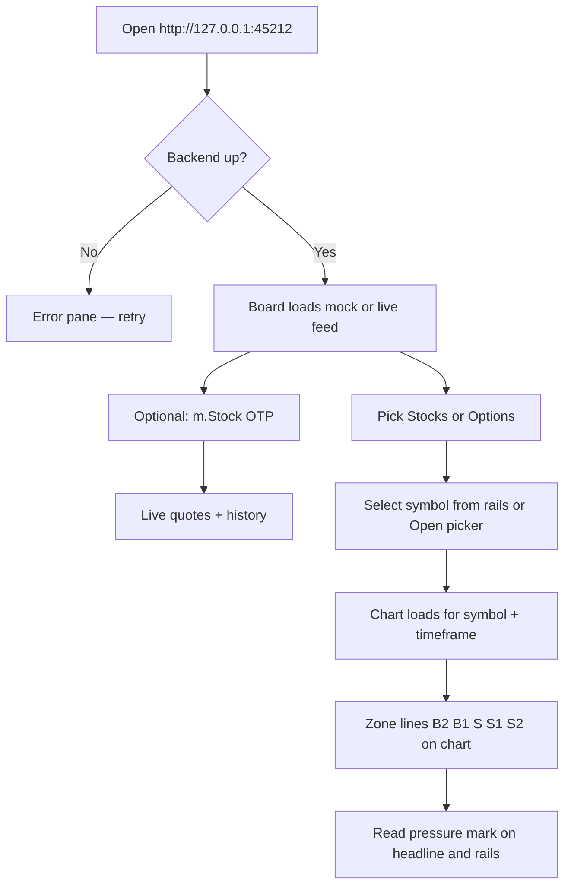

# Architecture — Trade with Beast

## What this project is

**Trade with Beast** is a trading **pressure board** with a Cursor/VS Code–style UI. It shows where NSE names sit relative to fixed zone lines (B2, B1, S, S1, S2) and labels each symbol **BUYING**, **SELLING**, or **RANGE BOUND**.

The board remains read-only with respect to the broker. A separate **paper-only decision agent** can
simulate confirmed stock and option positions; it has no live broker order method.

Index option hedging has an additional conservative policy: at least ₹1,00,000 must be allocated,
only one protected index spread may be open. Naked index and stock options plus naked
index and stock futures are allowed with liquidity checks, margin checks on short options,
stop-based sizing, user confirmation, and chat notifications across NIFTY, SENSEX,
BANKNIFTY, FINNIFTY, and listed F&O names.

---

## High-level architecture

```
┌─────────────────────────────────────────────────────────────────┐
│  Browser — Angular 19 (port 45212)                              │
│  ┌──────────────┐  ┌──────────────┐  ┌────────────────────────┐ │
│  │ Selling rail │  │ Editor/chart │  │ Buying + range rails   │ │
│  │ (left)       │  │ + m.Stock OTP│  │ (right)                │ │
│  └──────────────┘  └──────────────┘  └────────────────────────┘ │
│         │                  │                    │               │
│         └──────────────────┼────────────────────┘               │
│                            │ GET /api/* (proxy)                 │
└────────────────────────────┼────────────────────────────────────┘
                             ▼
┌─────────────────────────────────────────────────────────────────┐
│  ASP.NET Core 8 API (port 45211)                                │
│  ┌─────────────────┐  ┌──────────────────┐  ┌───────────────┐ │
│  │ BoardController │  │ BrokerAuthController│ │ MockMarket   │ │
│  │ /api/board      │  │ /api/broker/*     │ │ Service       │ │
│  └────────┬────────┘  └────────┬─────────┘  │ (hosted 1s)   │ │
│           │                    │            └───────┬───────┘ │
│           └────────────────────┼────────────────────┘         │
│                                ▼                                │
│                    ┌───────────────────────┐                    │
│                    │ MStockAuthClient      │                    │
│                    │ (REST Type A)         │                    │
│                    └───────────┬───────────┘                    │
└────────────────────────────────┼────────────────────────────────┘
                                 ▼
                    https://api.mstock.trade
                    (when OTP session active)
```

---

## Repository layout

```
Automation-Trading-Application/
├── backend/
│   ├── Broker/           # m.Stock client, index universe, option symbol keys
│   ├── Controllers/      # REST API
│   ├── Formulas/         # Locked zone lines (NiftyZoneFormula, BlackScholes)
│   ├── Models/           # DTOs (board, chart, counts)
│   ├── Services/         # MockMarketService — board tick + chart data
│   └── data/
│       └── mock-board.json   # Seed OHLC when broker offline
├── frontend/
│   └── src/app/
│       ├── app.component.*   # Full IDE board UI + chart
│       └── core/             # board.service, board.models
├── HOW-TO-RUN.md
└── ARCHITECTURE.md
```

---

## Core domain: zone formula

All zone lines come from **yesterday / two-days-ago OHLC + today open**. Nothing is stored in SQL; values are computed on each tick.

| Line | Formula |
|------|---------|
| **B1** | AVERAGE(yesterday High, today Open) |
| **S1** | AVERAGE(yesterday Low, today Open) |
| **B2** | AVERAGE(High 2 days ago, yesterday High) |
| **S2** | AVERAGE(Low 2 days ago, yesterday Low) |
| **S** | AVERAGE(yesterday High, yesterday Low, today Open) |

Implementation: `backend/Formulas/NiftyZoneFormula.cs`

### Pressure marks (v1)

| Condition | Mark |
|-----------|------|
| last ≥ B1 | **BUYING** |
| last ≤ S1 | **SELLING** |
| else | **RANGE BOUND** |

**Tight range** → forced **RANGE BOUND**:

- NIFTY / FINNIFTY: \|B1 − S1\| < 80  
- SENSEX: \|B1 − S1\| < 250  
- Stocks: \|B1 − S1\| < 0.35% of today Open  

---

## Data flow

### 1. Board tick (every 1 second)

```
MockMarketService (IHostedService timer)
    │
    ├─ Has m.Stock session?
    │     YES → RefreshLiveAsync()
    │           → GET quote/ohlc (batched symbols)
    │           → Update Last, Open, tokens per symbol
    │     NO  → MockWalk() random walk on seed prices
    │
    └─ Snapshot() → GET /api/board
          → symbols[] with zones + mark + counts
```

Frontend polls `GET /api/board` via `BoardPollStore` (interval from `environment.boardPollMs`: **1000** dev, **3000** QA, **6000** production). Polling survives single-request failures and auto-recovers when the backend returns.

### 2. Chart request

```
User selects symbol + timeframe (e.g. RELIANCE, 5m)
    │
    ▼
GET /api/board/chart/RELIANCE?interval=5minute
    │
    ├─ m.Stock session + instrument token?
    │     YES → historical candles for that interval
    │     NO  → synthetic intraday bars (session-shaped)
    │           (daily candles are NOT reused on 5m/1m — avoids fat blocks)
    │
    └─ ChartResponse { candles, last, b2..s2 }
          │
          ▼
    Lightweight Charts (CDN) in app.component
          → candlestick series + B2/B1/S/S1/S2 price lines
```

### 3. Broker auth

```
UI: Send OTP → POST /api/broker/otp/send
UI: Verify   → POST /api/broker/otp/verify  { otp }
                    │
                    ▼
              MStockAuthClient.VerifyOtpAsync
                    │
                    ▼
              Token → %APPDATA%\TradeWithBeast\mstock-session.json
                    │
                    ▼
              Subsequent API calls: Authorization: token {api_key}:{access_token}
```

Credentials (API key, username, password) live in **.NET user secrets** (`trade-with-beast-mstock`), not in git.

---

## Frontend structure

| Area | Role |
|------|------|
| **Activity bar** | Switch **Stocks** vs **Options**; open symbol picker |
| **Left rail** | Selling pressure (stocks) or CE chain (options) |
| **Right rail** | Buying + range (stocks) or PE chain (options) |
| **Editor** | Selected symbol headline, zone chips, chart, code-style zone display |
| **Status bar** | Feed source, BUYING/SELLING/RANGE counts, mode (STOCKS/OPTIONS) |
| **m.Stock bar** | OTP login (faster than chat for session setup) |

Charts use **TradingView Lightweight Charts** (`lightweight-charts@4.2.3` in `index.html`), fed by backend candles — not the tradingview.com embed (NSE symbols are blocked there).

### Options mode (selection only)

- User picks underlying (NIFTY, SENSEX, BANKNIFTY, FINNIFTY), expiry, strike, CE/PE  
- Chart uses **underlying** candles; option premium display is derived (live NFO option chain is planned via m.Stock `NFO:` quote keys)  
- **No orders**

---

## Backend services

| Component | Responsibility |
|-----------|----------------|
| **MockMarketService** | Seed load, 1s tick, live/mock prices, board snapshot, chart assembly |
| **MStockAuthClient** | OTP, OHLC quotes, historical candles, session token |
| **IndexUniverse** | Nifty 50 + index names + m.Stock quote aliases |
| **SeedStore** | Reads `data/mock-board.json` |
| **MStockSessionStore** | Persists access token to AppData |
| **MarketContextService** | Normalizes quote provenance/freshness/liquidity and computes EMA, momentum, realized volatility, zone and regime evidence |
| **PaperDecisionEngine** | Deterministically ranks stock-zone, long-option, debit-spread and hedged-credit-spread candidates |
| **PortfolioRiskManager** | Applies capital, daily/aggregate risk, lot, liquidity, freshness, correlation and session constraints |
| **PaperTradingAgent** | Requires confirmation, revalidates all legs, simulates atomic fills and manages exits |
| **TradeHistoryStore** | Versioned SQLite persistence for decisions, evidence, multi-leg trades, legs and events while preserving `trade_history` |

### Paper decision lifecycle

1. Fresh context is built outside the agent state lock.
2. Strategies generate auditable candidates; evidence scores are rule scores, not probabilities.
3. Risk checks apply 2026 lots (NIFTY 65, BANKNIFTY 30, FINNIFTY 60, SENSEX 20).
4. One proposal is persisted and waits for explicit `CONFIRM`.
5. Confirmation refreshes and revalidates every leg. Any failed leg cancels the whole fill.
6. A SQLite transaction records the simulated all-leg fill. Marks and exits are persisted per leg.
7. Hard-stop, target, trailing, time, adverse-regime and 15:20 IST exits are enforced.

Open paper trades are reconstructed from persisted legs after restart. Proposals expire on restart;
rolls and strike changes are never applied to an existing approval.

### Paper-agent API

- `GET /api/paper-agent` — full additive snapshot
- `POST /api/paper-agent/command` — conversational start/status/confirm/reject/stop
- `GET /api/paper-agent/history?range=today|1m|3m|all` — compatible flat history
- `GET /api/paper-agent/trades?range=today|1m|3m|all` — strategy and per-leg paper history
- `GET /api/paper-agent/decisions`
- `GET /api/paper-agent/market-context`
- `GET /api/paper-agent/positions`
- `GET /api/paper-agent/events?limit=50`
- `GET /api/paper-agent/performance`

---

## Symbol universe

- **Indices:** NIFTY, SENSEX, BANKNIFTY, FINNIFTY  
- **Stocks:** Union of Nifty 50, Sensex 30, Bank Nifty, Fin Nifty constituents (deduped)  
- **Quote aliases:** e.g. NIFTY → `NSE:NIFTY 50`, SENSEX → `BSE:SENSEX` (see `IndexUniverse.QuoteKeys`)

---

## Security and secrets

| Store | Contents |
|-------|----------|
| User secrets | `MStock:ApiKey`, `Username`, `Password` |
| AppData JSON | Access token after OTP |
| Git | **Never** commit secrets, `.env`, or `appsettings.Development.json` with keys |

`.gitignore` excludes `node_modules/`, `bin/`, `obj/`, `.angular/`, secrets files.

---

## Technology stack

| Layer | Tech |
|-------|------|
| API | ASP.NET Core 8, minimal hosting |
| UI | Angular 19, standalone components, SCSS |
| Chart | TradingView Lightweight Charts 4.x (CDN) |
| Broker | m.Stock REST Type A |
| Storage | JSON seed/session plus local Microsoft.Data.Sqlite paper history (12-month retention) |

---

## Out of scope

- Live broker order placement (the agent is intentionally paper-only)
- Dual-MA, RSI, or replacing zone formulas  
- TradingView.com widget embed for NSE  
- Full live NFO option chain on chart (partial groundwork: `OptionSymbols`, `BlackScholes`, quote-by-key API)

---

## End-to-end user flow



---

## Related docs

- **[HOW-TO-RUN.md](./HOW-TO-RUN.md)** — install, run, OTP, troubleshooting
